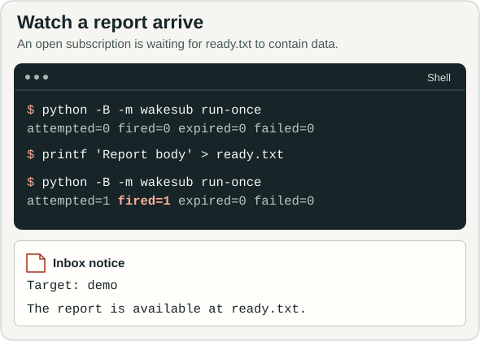

<h1><picture>
  <source media="(prefers-color-scheme: dark)" srcset="docs/assets/banner.svg">
  
</picture></h1>

Register a condition before a session goes idle and deliver a notice when it is met.

[](LICENSE)   [](https://github.com/T7H7N/wakesub/actions/workflows/tests.yml)

**[Get started](#quick-start)**　·　English · [한국어](README.ko.md)

### What it solves

<table>
<tr>
  <td width="33%" valign="top"><br><strong>Conditions</strong><br>Watch a time, a file, or a previous subscription.</td>
  <td width="33%" valign="top"><br><strong>Observation</strong><br>Poll outside the session and record the observed event.</td>
  <td width="33%" valign="top"><br><strong>Delivery</strong><br>Deliver through a configured command or inbox folder.</td>
</tr>
</table>

<picture>
  <source media="(max-width: 600px)" srcset="docs/assets/workflow-compact.svg">
  
</picture>

<picture>
  <source media="(max-width: 600px)" srcset="docs/assets/usage-compact.svg">
  
</picture>

An idle agent session cannot wake itself when a deadline arrives or another process writes a file. wakesub polls conditions outside the session and delivers a short message through a local command or an inbox folder. It requires Python 3.9 or later and uses only the standard library.

## Three ways to subscribe to a wake

The session runs one of these commands before going idle. A separate wakesub poller delivers the notice through the configured adapter.

1. **A delegated worker writes its result.** Use `--file` for a completion marker, even an empty one, or `--file-nonempty` for the result file.

   ```sh
   python -B -m wakesub add --file-nonempty report.md --target demo --say "The delegated worker has written data to report.md."
   ```

   Notice — “The delegated worker has written data to report.md.”

2. **A scheduled time arrives.** Pick a time still ahead today or give a full date and time.

   ```sh
   python -B -m wakesub add --at 16:30 --target demo --say "The scheduled 16:30 check-in time has arrived."
   ```

   Notice — “The scheduled 16:30 check-in time has arrived.”

3. **A previous wake fires.** Replace `PREVIOUS_ID` with the subscription ID returned by the earlier `add`.

   ```sh
   python -B -m wakesub add --after PREVIOUS_ID --target demo --say "The previous wake subscription has fired."
   ```

   Notice — “The previous wake subscription has fired.”

Keep notices factual because capable models can reject injected instructions. For an adapter that wakes an idle Claude Code session, see the [Claude Code examples](examples/claude-code/README.md). [Korean README](README.ko.md)

## Quick start

From this directory, run these five lines. On Windows you can also invoke the supplied launcher as `./wakesub.cmd` in PowerShell or `.\wakesub.cmd` at the command prompt.

```sh
python -B -m wakesub add --file-nonempty ready.txt --target demo --say "The report is available at ready.txt."
python -c "from pathlib import Path; Path('ready.txt').write_text('Report body', encoding='utf-8')"
python -B -m wakesub --config examples/file.json run-once
python -B -m wakesub list
python -c "from pathlib import Path; print(max(Path('examples/inbox').glob('*.md'), key=lambda p: p.stat().st_mtime_ns).read_text(encoding='utf-8'))"
```

`add` prints a subscription ID. Pass it to `drop` to remove a subscription, or use it in another subscription's `--after`. An open dependent must be removed or reach a terminal stage before its predecessor can be dropped. Global `--store` and `--config` options go before the subcommand. The defaults are `.wakesub` and `wakesub.json` under the working directory. Only `run-once` and `daemon` load the configuration file.

## Conditions

| Option | Observed condition | Default expiry |
| --- | --- | --- |
| `--at TIME` | The clock has reached `TIME`. It must be in the future at registration. | None |
| `--file PATH` | A regular file exists at `PATH`, including a zero-byte file. | 6 hours |
| `--file-nonempty PATH` | A regular file exists and has at least one byte. | 6 hours |
| `--after ID` | The referenced subscription has reached `fired`. | 2 days |

Use exactly one condition. `--say` takes 1 to 300 printable characters. Describe what happened and include any relevant path or time. `--target` takes 1 to 200 printable characters and is interpreted by the adapter. Relative watched paths are anchored to the working directory at registration.

With `--at` or `--until`, use `HH:MM` for today in the machine's local time or an ISO date and time with optional seconds. Use an explicit offset around clock changes. `--ttl` is a positive duration from registration, such as `6h` or `1.5d`. Use `--ttl` or `--until` to override the default. A timer's expiry must follow its scheduled time. When a poll reaches the deadline before observing the condition, it queues a message marked as expired. Add `--quiet-expire` to record expiry without a message. Once the poll observes and records an event, it keeps that decision across throttling and retries.

## Delivery adapters

The config is a JSON object. `budget` caps delivery attempts per cycle and defaults to 5. `target_interval` sets the minimum seconds between attempts for the same target in the same store and defaults to 30. Set it to 0 to disable the interval. `max_attempts` includes the initial attempt and defaults to 3. `interval` sets the daemon's pause between completed cycles in seconds and defaults to 10. Retried deliveries and expiry messages count toward the budget. Quiet expiry consumes no delivery slots.

- **`command`** is the default adapter type. Configure `adapter.argv` as an array starting with a fixed executable. The remaining arguments can contain `{target}`, `{message}`, `{id}`, or `{event}`. If `{message}` appears, it is passed in the specified argument. Otherwise the message goes to standard input as UTF-8. The command runs directly without a shell. On Windows use a native executable. `adapter.timeout` defaults to 30 seconds. A zero exit code confirms acceptance and output is discarded. Use a command whose nonzero exit codes mean a retry is safe, or deduplicate by `{id}` at the receiver.
- **`file`** writes one UTF-8 Markdown file named with the subscription ID to `adapter.inbox`. It contains the target and the message. A relative inbox is resolved from the config file's directory. The receiving process can watch for `*.md` and consume those files. Set `adapter.signal` to `true` to also touch the inbox's `signal` file after publishing. In this mode the receiver can rename a notice to `<id>.delivered` to acknowledge it and suppress replay. [File config](examples/file.json)
- **`noop`** reports success without an external action. Use `{"adapter": {"type": "noop"}}` to exercise state transitions.

The command config illustrates `claude -p --resume <session-id>` with `{target}` in place of `<session-id>` and the message on standard input. It is an example to adapt to your own CLI. Check the flags and input behavior against your installed executable's help. [Command config](examples/command.json)

To write another adapter, implement `deliver(delivery)` and pass the adapter object to `wakesub.engine.run_once`. The `Delivery` object contains `subscription_id`, `target`, `event`, and `message`. Return after acceptance. Raise `DeliveryError` when retrying is safe or `DeliveryUncertain` when delivery may already have happened. An unexpected adapter exception is treated as an uncertain outcome. A fake clock can be passed as `clock` and should return seconds since the Unix epoch.

```python
from pathlib import Path
from wakesub.engine import run_once
from wakesub.store import Store

class RecordingAdapter:
    def __init__(self):
        self.messages = []

    def deliver(self, delivery):
        self.messages.append(delivery)

recording = RecordingAdapter()
summary = run_once(Store(Path("scratch-state")), recording)
```

## Scheduled runs

- **Windows Task Scheduler.** Create a repeating trigger. In the action, set **Program/script** to your Python executable, **Add arguments** to `-B -m wakesub --config examples/file.json run-once`, and **Start in** to the directory containing this README. Run the task under an account that can read the watched paths and write the store and inbox. Use the task setting that skips a new instance while one is running.
- **cron.** For a copy in `tools/wakesub` under your home directory, poll once per minute with the following entry. Capture scheduler output somewhere you can review delivery failures.

```cron
* * * * * cd "$HOME/tools/wakesub" && python3 -B -m wakesub --config examples/file.json run-once >> wakesub.log 2>&1
```

For a foreground worker, use `python -B -m wakesub --config examples/file.json daemon`. A competing `run-once` exits with an error while the store is busy. A daemon logs the contention and tries again on its next cycle. Both print cycle totals. A terminal delivery failure is recorded in state and logged on standard error. A cycle that processed a failed subscription still exits successfully. CLI argument errors exit with status 2 and configuration, lock, or store errors with status 1.

## Design notes

- A producer can create an empty output before writing its body. Use `--file-nonempty` when an empty file would wake the receiver too early.
- A file can be present before registration. A matching path wakes on the next eligible poll, without waiting for a second create event.
- A time entered for earlier today could cause an immediate wake or silently roll into tomorrow. Registration accepts future times only.
- A file can disappear or become inaccessible during a poll. A failed filesystem probe leaves the condition unobserved for that poll.
- Each subscription occupies one JSON record. Updates use a temporary file and atomic replacement. The folder lock serializes cycles and covers delivery, so overlapping runs cannot send the same record. The store also keeps a lock file and timestamps for target throttling.
- The lifecycle is `open` to `fired`, `expired`, or `failed`. A successful expiry notification reaches `expired`. A failed expiry notification can reach `failed`, with its intended event retained in the record. A recorded in-progress attempt found after interruption is marked `failed` without a repeat. A command timeout is also treated as an uncertain delivery.
- An adapter that detects an offline session returns a failure. wakesub records `failed` after the allowed attempts or when the outcome is uncertain. If the adapter relaunches the session through an app URL or CLI resume, give it a daily launch cap.
- A receiver can defer a wake after recent human input. The poller already applies the per-cycle budget and the per-target interval.
- Run `python -B -m wakesub prune` to remove `fired` and `expired` records after 8 days and `failed` records after 30 days. Set `--done-days N` and `--failed-days M` to override the defaults with nonnegative whole days. Age starts at completion, or at the record file's last modification for older records. Open subscriptions and the predecessors they still reference are kept.

## Limits

Polling can miss files that appear and vanish between cycles. A nonempty file can still be incomplete. Publish a separate completion marker or atomically rename the finished file when completeness matters. Event timing depends on polling, the budget, command execution time, and the machine clock.

An adapter can confirm command exit or file handoff. Only the receiver can confirm that an agent actually resumed and acted. A crash between recording an attempt and saving its outcome can leave a message undelivered or already accepted. Uncertain attempts are marked failed for review. A command that accepts a message and then exits unsuccessfully may send duplicates if the receiver does not deduplicate.

Use a local filesystem and a trusted config, store, and scheduler working directory. File locking across machines and recovery after power loss are outside the supported scope. Terminal records remain until `drop` or `prune`. The store keeps one throttle timestamp per used target. Command output is discarded and command timeouts do not control detached descendants. Keep separate stores for independent queues.

## Not included

- Mail archive conditions.
- Work ledger integration.
- Chat bot notifications.
- Operator workflow actions.

## Related work

- cc-peer sends messages to the receiving socket of a running Claude Code session. [cc-peer](https://pypi.org/project/cc-peer/)
- raw-async-delivery (pi-shell-acp) delivers asynchronously to running agent sessions and wakes idle Claude Code sessions through `FileChanged` and `watchPaths`. It is the precedent for the hook example. [Package](https://www.npmjs.com/package/@junghanacs/pi-shell-acp)
- TaskWake resumes sessions stopped by usage limits or overload with `claude --resume` when capacity returns. [TaskWake](https://github.com/Mira190/TaskWake)
- herdctl starts new agent jobs on schedules, webhooks, or chat events. [herdctl](https://github.com/edspencer/herdctl)
- unsnooze and claude-powernap resume the same session when usage limits lift. [unsnooze](https://github.com/saaranshM/unsnooze) · [claude-powernap](https://pypi.org/project/claude-powernap/)

wakesub handles condition subscriptions for times, files, and previous wakes, with expiry notices and a per-cycle budget. The delivery adapter is pluggable and can use these tools where their delivery behavior fits.

## Feedback

Tried it? Share what worked and what got in the way in [Discussions](https://github.com/T7H7N/wakesub/discussions). Use [Issues](https://github.com/T7H7N/wakesub/issues) for bugs.
